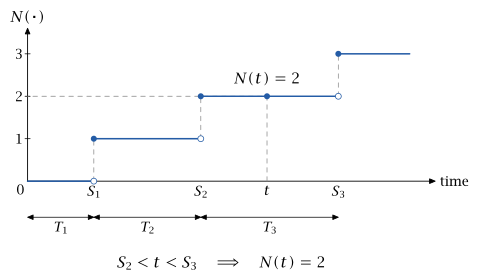
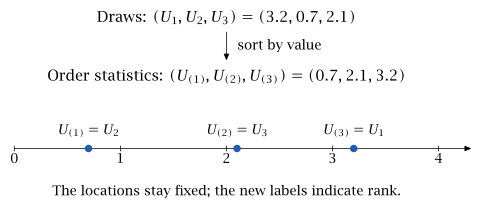
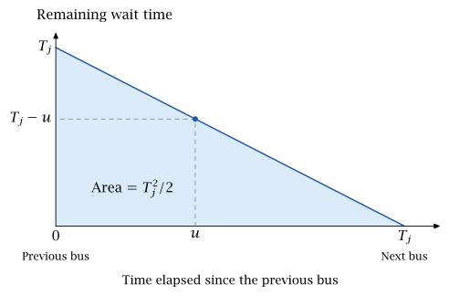

The Bernoulli process describes arrivals in discrete time. We now develop its continuous-time analogue, the Poisson process. We first introduce the process through exponential interarrival times and derive its counting properties. We then study superposition, splitting, and conditional arrival times, and connect the construction to continuous-time Markov chains.

## From Bernoulli processes to Poisson processes

1. Recall the Bernoulli process from @exm-bernoulli-process. Let $\{B_n\}_{n\ge1}$ be i.i.d. $\operatorname{Bernoulli}(p)$ random variables, where $B_n=1$ indicates an arrival at time $n$. The number of arrivals by time $n$ is
   $$
   N_n=\sum_{j=1}^nB_j,
   $$
   so $N_n\sim\operatorname{Binom}(n,p)$.

2. The Bernoulli variables have mean $p$ and variance $p(1-p)$. Since $N_n=\sum_{j=1}^nB_j$, linearity of expectation and independence give
   \begin{align*}
   \EXP[N_n]&=\sum_{j=1}^n\EXP[B_j]=np,\\
   \VAR(N_n)&=\sum_{j=1}^n\VAR(B_j)=np(1-p).
   \end{align*}

3. The random variables $B_1,B_2,\ldots$ are independent. Thus their auto-covariance is
   $$
   \COV(B_m,B_n)=
   \begin{cases}
   p(1-p), & m=n,\\
   0, & m\ne n.
   \end{cases}
   $$
   The cumulative counts share arrivals: for example, $N_{n+1}=N_n+B_{n+1}$. Consequently, for $0<p<1$, the counts $N_1,N_2,\ldots$ are dependent, as the covariance calculation below confirms.

4. For every $n\ge0$ and $h\ge1$,
   $$
   N_{n+h}-N_n=B_{n+1}+\cdots+B_{n+h}
   \sim\operatorname{Binom}(h,p).
   $$
   Thus, the distribution of an increment depends on its length $h$ but not on its starting time $n$. Increments over disjoint time intervals are sums over disjoint sets of the independent variables $B_j$, so the increments are independent. Hence the Bernoulli counting process has **stationary independent increments**.

5. To compute the auto-covariance of the counting process, suppose $0\le m\le n$ and write
   $$
   N_n=N_m+(N_n-N_m).
   $$
   The first term counts arrivals at times $1,\ldots,m$, while the second counts arrivals at times $m+1,\ldots,n$. These terms are independent. Hence,
   \begin{align*}
   \COV(N_m,N_n)
   &=\COV(N_m,N_m)+\COV(N_m,N_n-N_m)\\
   &=\VAR(N_m)\\
   &=mp(1-p).
   \end{align*}
   By symmetry, for arbitrary $m,n\ge0$,
   \begin{equation}\label{eq:bernoulli-counting-covariance}
   \COV(N_m,N_n)=p(1-p)\min(m,n).
   \end{equation}
   The covariance comes from the arrivals shared by the two counts; arrivals after the earlier time contribute no covariance.

6. There are two equivalent ways to describe the arrivals. Let

   - $T_k$ be the time between the $(k-1)$-st and $k$-th arrivals;
   - $S_k=T_1+\cdots+T_k$ be the time of the $k$-th arrival.

   For a Bernoulli process, the interarrival times $T_1,T_2,\ldots$ are i.i.d. geometric random variables. The counting process and arrival times contain the same information:
   $$
   \{N_n\ge k\}=\{S_k\le n\}.
   $$

7. To pass to continuous time, divide an interval of length $t$ into $m$ short intervals and suppose that an arrival occurs in each interval with probability $λt/m$. The number of arrivals is binomial, and for every fixed $k$,
   $$ \binom mk\left(\frac{λt}{m}\right)^k
     \left(1-\frac{λt}{m}\right)^{m-k}
     \longrightarrow
     e^{-λt}\frac{(λt)^k}{k!}
     \qquad\text{as }m\to\infty.
   $$
   This rare-event limit suggests that the number of continuous-time arrivals in an interval of length $t$ should have a $\operatorname{Poisson}(λt)$ distribution.

## Exponential interarrival times

1. The geometric distribution is the only memoryless distribution on the positive integers. Its continuous-time analogue is the exponential distribution. If $T\sim\operatorname{Exp}(λ)$, where $λ>0$, then
   $$
   f_T(t)=λe^{-λt},
   \qquad
   F_T(t)=1-e^{-λt},
   \qquad
   t\ge0.
   $$
   Its MGF is
   $$
   M_T(s)=\frac{λ}{λ-s},
   \qquad \operatorname{Re}(s)<λ.
   $$
   Its mean and variance are
   $$
   \EXP[T]=\frac1λ,
   \qquad
   \VAR(T)=\frac1{λ^2}.
   $$
   The parameter $λ$ is called the **rate**.

2. The exponential distribution is memoryless: for $u,t\ge0$,
   $$
   \PR(T>u+t\mid T>u)
   =\frac{e^{-λ(u+t)}}{e^{-λu}}
   =e^{-λt}
   =\PR(T>t).
   $$
   Thus, given that no arrival has occurred by time $u$, the remaining waiting time has the same distribution as the original waiting time.

3. The converse is also true.

   :::{#exm-memoryless-exponential}
   #### Continuous memoryless distributions

   Let $T$ be a nonnegative continuous random variable such that
   $$
   \PR(T>u+t\mid T>u)=\PR(T>t)
   $$
   for every $u,t\ge0$. Then $T$ has an exponential distribution.
   :::

   :::{.callout-note collapse="true"}
   #### Solution

   Let $\overline F(t)=\PR(T>t)$. The memoryless property gives
   $$
   \overline F(u+t)=\overline F(u)\overline F(t).
   $$
   Therefore, $g(t)=-\log\overline F(t)$ satisfies
   $$
   g(u+t)=g(u)+g(t).
   $$
   Since $\overline F$ is continuous, $g$ is continuous, and the continuous solutions of this equation are $g(t)=λt$ for some $λ\ge0$. For a proper nondegenerate distribution, $λ>0$. Hence
   $$
   \overline F(t)=e^{-λt}.
   $$
   :::

## Construction of the Poisson process

1. Let $T_1,T_2,\ldots$ be i.i.d. $\operatorname{Exp}(λ)$ random variables and define
   $$
   S_0=0,
   \qquad
   S_k=T_1+\cdots+T_k,
   \quad k\ge1.
   $$
   The random variable $S_k$ is the time of the $k$-th arrival. The associated counting process is
   \begin{equation}\label{eq:poisson-counting-process}
   N(t)=\max\{k\ge0:S_k\le t\},
   \qquad t\ge0.
   \end{equation}
   The process $\{N(t)\}_{t\ge0}$ is called a **Poisson process with rate $λ$**.

   The counting process and the arrival times contain the same information. In particular,
   $$
   N(t)=\sum_{k=1}^{∞}\IND\{S_k\le t\},
   \qquad
   S_k=\inf\{t\ge0:N(t)\ge k\}.
   $$
   The first identity counts the arrivals that have occurred by time $t$, while the second recovers the time of the $k$-th arrival from the counting process.

2. The sample paths of $N(t)$ are nondecreasing, right-continuous staircase functions. They start at zero and increase by one at each arrival time $S_k$.

   {#fig-poisson-arrival-counts width=90%}

```{ojs}
viewof poisson_rate = Inputs.range([0.5, 5], {label: "rate λ", value: 2, step: 0.5})
viewof rerun_poisson = Inputs.button("Generate sample path")

poisson_path = {
  rerun_poisson
  const horizon = 10
  const points = [{t: 0, N_t: 0}]
  let t = 0
  let count = 0
  while (true) {
    t += -Math.log(1 - Math.random()) / poisson_rate
    if (t > horizon) break
    count += 1
    points.push({t, N_t: count})
  }
  points.push({t: horizon, N_t: count})
  return points
}
```

```{ojs}
Plot.plot({
  grid: true,
  height: 180,
  x: {domain: [0, 10], label: "t"},
  y: {domain: [0, 50], label: "N(t)"},
  marks: [
    Plot.ruleY([0]),
    Plot.line(poisson_path, {x: "t", y: "N_t", curve: "step-after", strokeWidth: 1.5}),
    Plot.dot(poisson_path.slice(0, -1), {x: "t", y: "N_t", fill: "currentColor", r: 2})
  ]
})
```

3. Since $S_k$ is a sum of $k$ independent exponential random variables, it has an Erlang distribution:
   \begin{equation}\label{eq:erlang-density}
   f_{S_k}(t)
   =\frac{λ^k t^{k-1}e^{-λt}}{(k-1)!},
   \qquad t\ge0.
   \end{equation}

   :::{.callout-note collapse="true"}
   #### Proof

   We use induction and convolution. For $k=1$, this is the exponential density. If the formula holds for $S_k$, then independence of $S_k$ and $T_{k+1}$ gives, for $t\ge0$,
   \begin{align*}
   f_{S_{k+1}}(t)
   &=\int_0^t f_{S_k}(u)f_{T_{k+1}}(t-u)\,du\\
   &=\int_0^t\frac{λ^k u^{k-1}e^{-λu}}{(k-1)!}
     λe^{-λ(t-u)}\,du\\
   &=\frac{λ^{k+1}e^{-λt}}{(k-1)!}\int_0^t u^{k-1}\,du\\
   &=\frac{λ^{k+1}t^k e^{-λt}}{k!},
   \end{align*}
   which is the formula for $k+1$.
   :::

   Since expectations and variances add for independent summands,
   $$
   \EXP[S_k]=\frac kλ,
   \qquad
   \VAR(S_k)=\frac k{λ^2}.
   $$

4. The events $\{N(t)=k\}$ and $\{S_k\le t<S_{k+1}\}$ are the same. For $k\ge1$, conditioning on $S_k=u$, where $0<u<t$, gives
   \begin{align*}
   \PR(N(t)=k)
   &=\int_0^t f_{S_k}(u)\PR(T_{k+1}>t-u)\,du\\
   &=\int_0^t
   \frac{λ^k u^{k-1}e^{-λu}}{(k-1)!}
   e^{-λ(t-u)}\,du\\
   &=e^{-λt}\frac{(λt)^k}{k!}.
   \end{align*}
   The same formula holds for $k=0$ because $\PR(N(t)=0)=\PR(T_1>t)=e^{-λt}$. Therefore,
   \begin{equation}\label{eq:poisson-count-distribution}
   \boxed{
   N(t)\sim\operatorname{Poisson}(λt).
   }
   \end{equation}

5. It follows that
   $$
   \EXP[N(t)]=λt,
   \qquad
   \VAR(N(t))=λt.
   $$
   The process itself is not stationary because the distribution of $N(t)$ depends on $t$.

6. However, knowing that
   $$
   N(t)\sim\operatorname{Poisson}(λt)
   $$
   for every $t$ specifies only the one-dimensional marginal distributions of the process. It does not specify the dependence between counts at different times. In the next section, we show that the Poisson process has stationary independent increments, which supplies this temporal dependence.

## Increments and covariance

1. Fix a deterministic time $u\ge0$. Suppose we know the entire arrival history up to $u$: there have been $k$ arrivals, with the last at $S_k$. If $k=0$, use $S_0=0$. The current interarrival time has already lasted $a=u-S_k$, so our information about $T_{k+1}$ is that $T_{k+1}>a$.

   Let $R(u)=S_{N(u)+1}-u$ be the remaining time until the next arrival. Independence of the interarrival times and memorylessness give, for $h\ge0$,
   \begin{align*}
   \PR(R(u)>h\mid\text{arrival history up to }u)
   &=\PR(T_{k+1}>a+h\mid T_{k+1}>a)\\
   &=e^{-λh}.
   \end{align*}
   This probability does not depend on $k$, the previous arrival times, or the elapsed wait $a$. Therefore, the remaining wait time is exponential with rate $λ$ and independent of the arrival history.

   After the next arrival, the waiting times are $T_{k+2},T_{k+3},\ldots$. These are also independent exponential random variables with rate $λ$, independent of the history and the remaining wait time. Thus, viewed from time $u$, the future arrivals are generated by a fresh sequence of independent exponential waiting times. The process
   $$
   \{N(u+t)-N(u)\}_{t\ge0}
   $$
   has the same distribution as the original Poisson process and is independent of its history up to $u$. The past tells us how long we have already waited; memorylessness makes that information irrelevant to the remaining wait time.

   Consequently,
   \begin{equation}\label{eq:poisson-increment-distribution}
   N(t)-N(u)\sim\operatorname{Poisson}(λ(t-u)),
   \qquad 0\le u<t.
   \end{equation}
   Thus, the Poisson process has **stationary increments**.

2. The future process starting at $u$ is independent of the arrival history up to $u$, so counts after $u$ are independent of earlier counts. Repeating this argument at successive interval boundaries shows that counts over disjoint time intervals are independent. Therefore, the Poisson process has **independent increments**. Equivalently, for
   $$
   0\le t_0<t_1<\cdots<t_m,
   $$
   the random variables
   $$
   N(t_1)-N(t_0),\ldots,N(t_m)-N(t_{m-1})
   $$
   are independent.

3. For $0\le u\le t$,
   $$
   N(t)=N(u)+[N(t)-N(u)],
   $$
   where the two terms on the right are independent. Hence
   \begin{equation}\label{eq:poisson-covariance}
   \COV(N(u),N(t))=λu,
   \end{equation}
   or, for arbitrary $u,t\ge0$,
   $$
   \COV(N(u),N(t))=λ\min(u,t).
   $$
   This is the continuous-time counterpart of the Bernoulli counting-process covariance in \eqref{eq:bernoulli-counting-covariance}. In both cases, the covariance is the variance of the arrivals shared by the two counts.

:::{#exm-poisson-third-arrival-deadline}
#### The time of the third arrival

Let $\{N(t)\}_{t\ge0}$ be a Poisson process with rate $λ=2$ per minute, counting incoming requests. Let $S_3$ be the time of the third arrival, measured from time zero.

(a) Find the probability that the third arrival occurs after two minutes.

(b) Find the probability that the third arrival occurs between one and two minutes.

(c) Given that exactly one request has arrived by time one, find the probability that the third arrival occurs by time two.
:::

:::{.callout-note collapse="true"}
#### Solution

The key correspondence is
$$
\{S_3>t\}=\{N(t)\le2\}.
$$

(a) Since $N(2)\sim\operatorname{Poisson}(4)$,
$$
\PR(S_3>2)
=\sum_{k=0}^{2}e^{-4}\frac{4^k}{k!}
=13e^{-4}\approx0.2381.
$$

(b) Similarly, $\PR(S_3>1)=e^{-2}(1+2+2)=5e^{-2}$. Therefore,
\begin{align*}
\PR(1<S_3\le2)
&=\PR(S_3>1)-\PR(S_3>2)\\
&=5e^{-2}-13e^{-4}
\approx0.4386.
\end{align*}

(c) Given $N(1)=1$, two further requests are needed during $(1,2]$. The increment $N(2)-N(1)$ is independent of $N(1)$ and has a $\operatorname{Poisson}(2)$ distribution. Hence,
\begin{align*}
\PR(S_3\le2\mid N(1)=1)
&=\PR(N(2)-N(1)\ge2)\\
&=1-e^{-2}(1+2)
=1-3e^{-2}\approx0.5940.
\end{align*}
:::

:::{#exm-poisson-overlapping-intervals}
#### Counts in overlapping intervals

Let $\{N(t)\}_{t\ge0}$ be a Poisson process with rate $λ=2$ per minute. Define
$$
X=N(3)-N(1),\qquad Y=N(5)-N(2).
$$
Find their covariance, correlation coefficient, and $\PR(X=1,Y=1)$. Are $X$ and $Y$ independent?
:::

:::{.callout-note collapse="true"}
#### Solution

Split the intervals into three disjoint pieces:
$$
A=N(2)-N(1),\qquad
B=N(3)-N(2),\qquad
C=N(5)-N(3).
$$
By independent increments, $A,B,C$ are independent, with
$$
A\sim\operatorname{Poisson}(2),\qquad
B\sim\operatorname{Poisson}(2),\qquad
C\sim\operatorname{Poisson}(4).
$$
Since $X=A+B$ and $Y=B+C$,
$$
\COV(X,Y)=\VAR(B)=λ=2.
$$
The intervals counted by $X$ and $Y$ have lengths two and three minutes, respectively. Thus, $\VAR(X)=2λ=4$ and $\VAR(Y)=3λ=6$, so
$$
\operatorname{Corr}(X,Y)
=\frac{λ}{\sqrt{(2λ)(3λ)}}
=\frac{2}{\sqrt{4\cdot6}}
=\frac1{\sqrt6}.
$$

For $X=Y=1$, there are two disjoint possibilities: $(A,B,C)=(1,0,1)$ or $(0,1,0)$. Hence,
\begin{align*}
\PR(X=1,Y=1)
&=(2e^{-2})(e^{-2})(4e^{-4})
 +(e^{-2})(2e^{-2})(e^{-4})\\
&=10e^{-8}.
\end{align*}
Their positive covariance shows that $X$ and $Y$ are not independent.

More generally, if $N(I)$ denotes the number of arrivals in a time interval $I$, then
$$
\COV(N(I),N(J))=λ\,|I\cap J|,
$$
where $|I\cap J|$ is the length of the overlap. To see this, separate each count into the count on the overlap and the count outside it. These three counts are independent, so only the variance of the shared count contributes to the covariance.
:::

## Superposition of Poisson processes

1. Let $\{N_1(t)\}$ and $\{N_2(t)\}$ be independent Poisson processes with rates $λ_1$ and $λ_2$, and define
   $$
   N(t)=N_1(t)+N_2(t).
   $$
   Then $\{N(t)\}$ is a Poisson process with rate $λ_1+λ_2$.

2. To see this, consider any interval $(u,t]$. The increment
   $$
   N(t)-N(u)
   =[N_1(t)-N_1(u)]+[N_2(t)-N_2(u)]
   $$
   is the sum of independent Poisson random variables and therefore has a $\operatorname{Poisson}((λ_1+λ_2)(t-u))$ distribution. Increments over disjoint intervals remain independent, so this is a statement about the whole process, not about $N(t)$ at a single time.

3. More generally, the superposition of independent Poisson processes with rates $λ_1,\ldots,λ_m$ is a Poisson process with rate
   $$
   λ_1+\cdots+λ_m.
   $$

## Splitting a Poisson process

1. Suppose each arrival of a rate-$λ$ Poisson process is independently labeled type 1 with probability $p$ and type 2 with probability $1-p$. Let $N_1(t)$ and $N_2(t)$ count the two types. Then $\{N_1(t)\}$ and $\{N_2(t)\}$ are independent Poisson processes with rates $pλ$ and $(1-p)λ$, respectively.

2. For fixed $t$, conditional on $N(t)=j+k$, the pair $(N_1(t),N_2(t))$ has a binomial splitting distribution:
   $$
   \PR(N_1(t)=j,N_2(t)=k\mid N(t)=j+k)
   =\frac{(j+k)!}{j!k!}p^j(1-p)^k.
   $$
   Therefore,
   \begin{align*}
   &\PR(N_1(t)=j,N_2(t)=k)\\
   &\quad=
   \frac{(pλt)^j e^{-pλt}}{j!}
   \frac{((1-p)λt)^k e^{-(1-p)λt}}{k!}.
   \end{align*}
   The factorization shows both the marginal Poisson distributions and their independence. Applying the same argument on disjoint intervals gives independence of the two processes.

3. The same result holds for $r$ types. If an arrival is independently assigned type $i$ with probability $p_i$, where $p_1+\cdots+p_r=1$, then the type processes are independent Poisson processes with rates $p_iλ$.

:::{#exm-poisson-web-server}
#### Requests at a web server

Let $\{N(t)\}_{t\ge0}$ be a Poisson process with rate $λ=10$ per minute, counting requests received by a web server.

(a) What is the expected time of the 100th request?

(b) What is the probability that the time between the 100th and 101st requests exceeds one minute?

(c) Each request is from Canada independently with probability $1/5$. What is the probability that no request from Canada arrives during the next two minutes?
:::

:::{.callout-note collapse="true"}
#### Solution

(a) The 100th arrival time is $S_{100}=T_1+\cdots+T_{100}$, so
$$
\EXP[S_{100}]=\frac{100}{10}=10\text{ minutes}.
$$

(b) The waiting time $T_{101}$ is $\operatorname{Exp}(10)$, so
$$
\PR(T_{101}>1)=e^{-10}.
$$

(c) Thinning gives a Poisson process of Canadian requests with rate $2$ per minute. Thus,
$$
\PR(N_C(2)=0)=e^{-4}.
$$
:::

:::{#exm-poisson-three-streams}
#### Splitting into three streams

Let $\{N(t)\}_{t\ge0}$ be a Poisson process with rate $λ$. Independently assign every arrival to one of three streams with probabilities $p_1,p_2,p_3$. Show that the three output processes are independent, find their rates, and verify that their superposition recovers the original process.
:::

:::{.callout-note collapse="true"}
#### Solution

Let $N_i(t)$ count the arrivals assigned to stream $i$ by time $t$. Since every arrival is assigned to exactly one stream, $p_1+p_2+p_3=1$ and
$$
N_1(t)+N_2(t)+N_3(t)=N(t)
\qquad\text{for every }t\ge0.
$$

To identify the output processes, fix an interval $(u,t]$ of length $h=t-u>0$ and write $X_i=N_i(t)-N_i(u)$. Conditional on $N(t)-N(u)=k$, the vector $(X_1,X_2,X_3)$ has a multinomial distribution with $k$ trials and probabilities $p_1,p_2,p_3$. Thus, for nonnegative integers $k_1,k_2,k_3$ and $k=k_1+k_2+k_3$,
\begin{align*}
\PR(X_1=k_1,X_2=k_2,X_3=k_3)
&=e^{-λh}\frac{(λh)^k}{k!}
\frac{k!}{k_1!k_2!k_3!}
\prod_{i=1}^3p_i^{k_i}\\
&=\prod_{i=1}^3
\left[e^{-p_iλh}\frac{(p_iλh)^{k_i}}{k_i!}\right].
\end{align*}
The factorization shows that the three increments are independent and that
$$
N_i(t)-N_i(u)\sim\operatorname{Poisson}(p_iλ(t-u)).
$$

For disjoint time intervals, the original arrival counts are independent, and the assignments of their arrivals are independent as well. Hence the vectors of output increments on disjoint intervals are independent. Together with the factorization above, this proves that the three output processes are independent Poisson processes with rates $p_1λ,p_2λ,p_3λ$.

Their superposition has rate
$$
p_1λ+p_2λ+p_3λ=λ.
$$
Moreover, the identity $N_1(t)+N_2(t)+N_3(t)=N(t)$ shows that superposition recovers the original sample path, not just its distribution.
:::

:::{#exm-poisson-fixed-total}
#### Independent streams with a fixed total

Let $\{N(t)\}_{t\ge0}$ be a Poisson process with rate $λ$. Each arrival is independently marked red with probability $p\in(0,1)$ and blue otherwise. The marks are independent of the process. Let $R$ and $B$ be the red and blue counts during $[0,t]$, where $t>0$, and let $K=R+B$.

The splitting theorem says that $R$ and $B$ are independent. Yet if $K=10$, knowing $R$ determines $B$. Explain this, and calculate both the conditional and unconditional covariance.
:::

:::{.callout-note collapse="true"}
#### Solution

Conditional on $K=k$,
$$
R\mid K=k\sim\operatorname{Binom}(k,p),
\qquad B=k-R.
$$
Therefore,
$$
\COV(R,B\mid K=k)
=-\VAR(R\mid K=k)
=-kp(1-p).
$$
For $k\ge1$, the conditional correlation is $-1$: the two counts must add to the known total.

Unconditionally, the total is random, with $K\sim\operatorname{Poisson}(λt)$. By the law of total covariance,
\begin{align*}
\COV(R,B)
&=\EXP[\COV(R,B\mid K)]
 +\COV(\EXP[R\mid K],\EXP[B\mid K])\\
&=-p(1-p)\EXP[K]
 +\COV(pK,(1-p)K)\\
&=-p(1-p)λt+p(1-p)λt\\
&=0.
\end{align*}
The negative covariance at a fixed total is exactly offset by variation in the total: larger totals tend to produce more arrivals of both colours.

Zero covariance alone does not establish independence; independence follows from the splitting theorem. There is no contradiction because independence need not survive conditioning on a common total.
:::

## Conditional arrival times

1. Suppose that $N(t)=1$. Conditional on this event, the single arrival time $S_1$ is uniformly distributed on $[0,t]$. For $0 \le u \le t$,
   \begin{align*}
   \PR(S_1\le u\mid N(t)=1)
   &=\frac{\PR(N(u)=1,N(t)-N(u)=0)}{\PR(N(t)=1)}\\
   &=\frac{(λu)e^{-λu}e^{-λ(t-u)}}{(λt)e^{-λt}}\\
   &=\frac ut.
   \end{align*}

2. The **order statistics** of random variables $U_1,\ldots,U_k$ are their values arranged in increasing order, denoted by
   $$
   U_{(1)}\le U_{(2)}\le\cdots\le U_{(k)}.
   $$
   Thus, $U_{(1)}$ is the minimum, $U_{(k)}$ is the maximum, and $U_{(j)}$ is the $j$-th smallest value. The parentheses distinguish the rank from the original index: $U_2$ is the second draw, whereas $U_{(2)}$ is the second smallest draw. For example, if
   $$
   (U_1,U_2,U_3)=(3.2,0.7,2.1),
   $$
   then
   $$
   (U_{(1)},U_{(2)},U_{(3)})=(0.7,2.1,3.2).
   $$
   Independent draws from a continuous distribution have no ties with probability one. Their order statistics are generally dependent: knowing the smallest value constrains all the others.

   {#fig-poisson-order-statistics width=90%}

:::{#exm-uniform-second-order-statistic}
#### The second of three uniform points

Let $U_1,U_2,U_3$ be independent $\operatorname{Unif}(0,t)$ random variables, where $t>0$. Find the CDF and density of their second order statistic $U_{(2)}$.
:::

:::{.callout-note collapse="true"}
#### Solution

For $0\le u\le t$, the event $\{U_{(2)}\le u\}$ occurs exactly when at least two of the three draws are at most $u$. Each draw is at most $u$ with probability $u/t$, independently of the others. Therefore,
\begin{align*}
F_{U_{(2)}}(u)
&=\binom32\left(\frac ut\right)^2\left(1-\frac ut\right)
 +\left(\frac ut\right)^3\\
&=3\left(\frac ut\right)^2-2\left(\frac ut\right)^3.
\end{align*}
The CDF is zero for $u<0$ and one for $u>t$. Differentiating on $(0,t)$ gives
$$
f_{U_{(2)}}(u)=\frac{6u}{t^2}-\frac{6u^2}{t^3}
=\frac{6u(t-u)}{t^3},
\qquad 0<u<t,
$$
and the density is zero elsewhere. For example,
$$
\PR(U_{(2)}\le t/2)=3\left(\frac12\right)^2-2\left(\frac12\right)^3=\frac12.
$$
The useful step is to translate a statement about the $j$-th smallest value into a statement about how many draws lie below a threshold.
:::

3. Returning to the Poisson process, conditional on $N(t)=k$, where $k\ge1$, the arrival times
   $$
   0<S_1<\cdots<S_k<t
   $$
   have the same joint distribution as the order statistics of $k$ independent $\operatorname{Unif}(0,t)$ random variables. Their conditional joint density is
   $$
   f_{S_1,\ldots,S_k\mid N(t)}(u_1,\ldots,u_k\mid k)
   =\frac{k!}{t^k},
   $$
   on the region $0<u_1<\cdots<u_k<t$.

   :::{.callout-note collapse="true"}
   #### Proof

   First consider the first $k$ arrival times without conditioning on $N(t)$. The transformation from interarrival times to arrival times is $S_j=T_1+\cdots+T_j$. Its inverse is $T_j=S_j-S_{j-1}$, with $S_0=0$.

   For arrival-time values $u_1,\ldots,u_k$, set $u_0=0$ and $v_j=u_j-u_{j-1}$. The Jacobian of this inverse transformation is
   $$
   J=\frac{\partial(v_1,\ldots,v_k)}{\partial(u_1,\ldots,u_k)}
   =\MATRIX{
   1 & 0 & \cdots & 0\\
   -1 & 1 & \ddots & \vdots\\
   0 & \ddots & \ddots & 0\\
   0 & \cdots & -1 & 1
   }.
   $$
   This matrix is lower triangular with every diagonal entry equal to one, so
   $$
   \det J=\prod_{j=1}^k J_{jj}=1,
   \qquad |\det J|=1.
   $$
   For $k=1$, the matrix is simply $\MATRIX{1}$. The change-of-variables formula and independence of the exponential interarrival times therefore give
   \begin{align*}
   f_{S_1,\ldots,S_k}(u_1,\ldots,u_k)
   &=f_{T_1,\ldots,T_k}(u_1,u_2-u_1,\ldots,u_k-u_{k-1})|\det J|\\
   &=\prod_{j=1}^k λe^{-λ(u_j-u_{j-1})}\\
   &=λ^k e^{-λu_k},
   \qquad 0<u_1<\cdots<u_k.
   \end{align*}
   Given $S_k=u_k<t$, exactly $k$ arrivals occur by time $t$ if the next interarrival time exceeds $t-u_k$. This has probability $e^{-λ(t-u_k)}$, independently of the first $k$ interarrival times. Consequently, on $0<u_1<\cdots<u_k<t$,
   \begin{align*}
   f_{S_1,\ldots,S_k\mid N(t)}(u_1,\ldots,u_k\mid k)
   &=\frac{λ^k e^{-λu_k}e^{-λ(t-u_k)}}{\PR(N(t)=k)}\\
   &=\frac{λ^k e^{-λt}}{e^{-λt}(λt)^k/k!}\\
   &=\frac{k!}{t^k}.
   \end{align*}

   Why is this also the density of sorted uniform draws? The joint density of $k$ independent $\operatorname{Unif}(0,t)$ draws is $1/t^k$ on the cube $(0,t)^k$. Every strictly ordered tuple can arise from $k!$ permutations of the original draws. Sorting combines these possibilities, so the order statistics have joint density $k!/t^k$ on the ordered region. This proves the claimed equality in distribution.
   :::

   Notice that $S_1\sim\operatorname{Exp}(λ)$ without conditioning, whereas $S_1\mid N(t)=1\sim\operatorname{Unif}(0,t)$. Knowing that exactly one arrival occurred in $[0,t]$ changes the distribution of its location.

4. This result is useful for simulation. One can generate a Poisson process on $[0,t]$ by first drawing $N\sim\operatorname{Poisson}(λt)$, then drawing $N$ independent uniform random variables on $[0,t]$, and finally sorting them to obtain the arrival times.

5. We have therefore encountered three equivalent descriptions of a Poisson process:

   - The interarrival times are i.i.d. $\operatorname{Exp}(λ)$ random variables.
   - The process has stationary independent increments, with
     $$
     N(t)-N(u)\sim\operatorname{Poisson}(λ(t-u)),
     \qquad 0\le u<t.
     $$
   - On any interval $[0,t]$, first draw $N(t)\sim\operatorname{Poisson}(λt)$; conditional on $N(t)=k$, the $k$ arrival times are the order statistics of $k$ independent $\operatorname{Unif}(0,t)$ random variables.

:::{#exm-poisson-two-arrival-times}
#### Two conditional arrival times

Let $\{N(t)\}_{t\ge0}$ be a Poisson process with rate $λ$ and fix $t>0$. Given that $N(t)=2$, find the conditional joint density of $(S_1,S_2)$ and the conditional marginal density of $S_1$.
:::

:::{.callout-note collapse="true"}
#### Solution

The joint density is
$$
f_{S_1,S_2\mid N(t)}(u_1,u_2\mid2)
=\frac{2}{t^2},
\qquad 0<u_1<u_2<t.
$$
Therefore,
$$
f_{S_1\mid N(t)}(u\mid2)
=\int_u^t\frac{2}{t^2}\,dv
=\frac{2(t-u)}{t^2},
\qquad 0<u<t.
$$
:::

:::{#exm-poisson-first-last-arrivals}
#### The first and last arrivals

Let $\{N(t)\}_{t\ge0}$ be a Poisson process with rate $λ$ and fix $t>0$. Suppose we know that exactly three arrivals occurred during $[0,t]$. Let $S_1<S_2<S_3$ denote their arrival times. Given that $N(t)=3$, answer the following questions.

(a) Find the probability densities and expected values of $S_1$ and $S_3$.

(b) Find the expected time between the first and last arrivals.

(c) Find the probability that all three arrivals are contained in some interval of length $t/2$.
:::

:::{.callout-note collapse="true"}
#### Solution

Given $N(t)=3$, the arrival times are the order statistics of three independent $\operatorname{Unif}(0,t)$ variables.

(a) For $0\le x\le t$,
\begin{align*}
\PR(S_1>x\mid N(t)=3)&=\left(1-\frac xt\right)^3,\\
\PR(S_3\le x\mid N(t)=3)&=\left(\frac xt\right)^3.
\end{align*}
Differentiating gives, for $0<x<t$,
\begin{align*}
f_{S_1\mid N(t)=3}(x)&=\frac3t\left(1-\frac xt\right)^2,\\
f_{S_3\mid N(t)=3}(x)&=\frac{3x^2}{t^3}.
\end{align*}
Consequently,
\begin{align*}
\EXP[S_1\mid N(t)=3]
&=\int_0^t x\frac3t\left(1-\frac xt\right)^2\,dx=\frac t4,\\
\EXP[S_3\mid N(t)=3]
&=\int_0^t x\frac{3x^2}{t^3}\,dx=\frac{3t}{4}.
\end{align*}

(b) By linearity of conditional expectation,
$$
\EXP[S_3-S_1\mid N(t)=3]
=\frac{3t}{4}-\frac t4=\frac t2.
$$

(c) The interval may be chosen after observing the arrivals, so the event is $\{S_3-S_1\le t/2\}$. The ordered triple has conditional density $6/t^3$ on $0<u_1<u_2<u_3<t$. Integrating over $u_2$ gives
$$
f_{S_1,S_3\mid N(t)=3}(u,v)
=\int_u^v\frac6{t^3}\,du_2
=\frac{6(v-u)}{t^3},
\qquad 0<u<v<t.
$$
Writing $D=S_3-S_1$, we obtain
\begin{align*}
f_{D\mid N(t)=3}(d)
&=\int_0^{t-d}\frac{6d}{t^3}\,du\\
&=\frac{6d(t-d)}{t^3},
\qquad 0<d<t.
\end{align*}
Thus,
$$
\PR(D\le t/2\mid N(t)=3)
=\int_0^{t/2}\frac{6d(t-d)}{t^3}\,dd
=\frac12.
$$
By comparison, the probability that all three arrivals lie in the predetermined interval $[0,t/2]$ is only $(1/2)^3=1/8$.
:::

:::{#exm-poisson-earlier-count}
#### Reconstructing an earlier count

Let $\{N(t)\}_{t\ge0}$ be a Poisson process with rate $λ>0$ per minute, counting incoming requests. A log records that 12 requests arrived during the first hour, but their timestamps were lost.

(a) Find the probability that exactly five requests arrived during the first 20 minutes.

(b) Find the MMSE estimate of the number that arrived during those 20 minutes and the conditional mean-square error.

(c) Explain why these answers do not depend on $λ$.
:::

:::{.callout-note collapse="true"}
#### Solution

With time measured in minutes, for general times $0<u<t$, independent increments give, for $j=0,\ldots,k$,
\begin{align*}
\PR(N(u)=j\mid N(t)=k)
&=\frac{\PR(N(u)=j)\PR(N(t)-N(u)=k-j)}{\PR(N(t)=k)}\\
&=\binom kj\left(\frac ut\right)^j
\left(1-\frac ut\right)^{k-j}.
\end{align*}
Thus,
$$
N(u)\mid N(t)=k\sim\operatorname{Binom}(k,u/t).
$$

(a) Taking $u=20$, $t=60$, and $k=12$,
$$
\PR(N(20)=5\mid N(60)=12)
=\binom{12}{5}\left(\frac13\right)^5
\left(\frac23\right)^7
\approx0.1908.
$$

(b) The MMSE estimate is the conditional expectation:
$$
\widehat N(20)=\EXP[N(20)\mid N(60)=12]
=12\cdot\frac13=4.
$$
Its conditional mean-square error is
\begin{align*}
\EXP[(N(20)-4)^2\mid N(60)=12]
&=\VAR(N(20)\mid N(60)=12)\\
&=12\cdot\frac13\cdot\frac23
=\frac83.
\end{align*}

(c) The rate cancels from the conditional probability. Equivalently, given the total count, the arrival times are obtained by sorting independent uniform points over the hour. Each point falls in the first 20 minutes with probability $1/3$.
:::

## Competing Poisson processes

1. Let $T_1\sim\operatorname{Exp}(λ_1)$ and $T_2\sim\operatorname{Exp}(λ_2)$ be independent waiting times. Then
   $$
   \PR(\min(T_1,T_2)>t)
   =e^{-λ_1t}e^{-λ_2t}
   =e^{-(λ_1+λ_2)t},
   $$
   so
   $$
   \min(T_1,T_2)\sim\operatorname{Exp}(λ_1+λ_2).
   $$

2. The probability that process 1 produces the first arrival is
   \begin{align*}
   \PR(T_1<T_2)
   &=\int_0^\infty \PR(T_2>t)f_{T_1}(t)\,dt\\
   &=\int_0^\infty e^{-λ_2t}λ_1e^{-λ_1t}\,dt\\
   &=\frac{λ_1}{λ_1+λ_2}.
   \end{align*}
   This is another way to see the superposition and splitting results: the combined clock rings at rate $λ_1+λ_2$, and each ring comes from process $i$ with probability proportional to $λ_i$.

:::{#exm-poisson-alarm-streams}
#### Combining two alarm streams

Let $\{N_1(t)\}_{t\ge0}$ and $\{N_2(t)\}_{t\ge0}$ be independent Poisson processes with rates $λ_1=2$ and $λ_2=3$ per minute, counting reports from sensors A and B, respectively. Each A report is classified as an alarm with probability $1/2$, and each B report with probability $1/5$. All classifications are mutually independent and independent of the report times.

(a) Find the rate of the combined alarm process.

(b) Find the probability of no alarms during the next two minutes.

(c) Find the probability that the next alarm comes from sensor A.

(d) Are the combined alarm and nonalarm processes independent?
:::

:::{.callout-note collapse="true"}
#### Solution

(a) Thinning gives independent alarm processes with rates
$$
λ_A=2\cdot\frac12=1,
\qquad
λ_B=3\cdot\frac15=\frac35.
$$
Their superposition is Poisson with rate
$$
λ_{\mathrm{alarm}}=1+\frac35=\frac85
\quad\text{per minute}.
$$

(b) The number of alarms during two minutes is Poisson with mean $16/5$, so
$$
\PR(\text{no alarms in two minutes})
=e^{-16/5}\approx0.0408.
$$

(c) By the competing-exponential formula,
$$
\PR(\text{next alarm comes from A})
=\frac{λ_A}{λ_A+λ_B}
=\frac58.
$$

(d) Yes. Splitting each sensor's reports produces independent alarm and nonalarm processes. Since the sensors are independent, all four component processes are mutually independent. Combining the two alarm streams and the two nonalarm streams therefore yields independent processes.

The combined nonalarm rate is
$$
2\left(1-\frac12\right)+3\left(1-\frac15\right)
=1+\frac{12}{5}=\frac{17}{5}.
$$
The alarm and nonalarm rates sum to $5$, the original total report rate.
:::

:::{#exm-poisson-arrival-race}
#### A race between several arrivals

Let $\{N_1(t)\}_{t\ge0}$ and $\{N_2(t)\}_{t\ge0}$ be independent Poisson processes with rates $λ_1=2$ and $λ_2=1$ per minute. Find the probability that the third arrival of process 1 occurs before the second arrival of process 2.
:::

:::{.callout-note collapse="true"}
#### Solution

Let $S_k^{(i)}$ denote the time of the $k$-th arrival of process $i$. The superposition of the two processes has rate $3$. Successive arrival labels are independent, with probabilities
$$
p=\frac23\quad\text{for process 1},
\qquad
1-p=\frac13\quad\text{for process 2}.
$$

Let $K$ count the process-2 arrivals before the third process-1 arrival. For $K=k$, the last arrival must have label 1, while the preceding $k+2$ arrivals contain exactly two labels of type 1. Thus,
$$
\PR(K=k)=\binom{k+2}{2}p^3(1-p)^k,
\qquad k=0,1,\ldots.
$$
This is a negative-binomial distribution, counting failures before the third success. The desired event occurs exactly when $K\le1$, so
\begin{align*}
\PR(S^{(1)}_3<S^{(2)}_2)
&=p^3+3p^3(1-p)\\
&=\frac8{27}+\frac8{27}
=\frac{16}{27}.
\end{align*}

Alternatively, process 1 wins precisely when at least three of the first four combined arrivals have label 1. Indeed, in that case the third process-1 arrival occurs among the first four arrivals, with at most one process-2 arrival before it. Otherwise, the second process-2 arrival occurs among the first four arrivals, before the third process-1 arrival. Hence the same probability is
$$
\binom43p^3(1-p)+p^4=\frac{16}{27}.
$$
:::

## Renewal processes

1. The Poisson process is a special case of a broader class of counting processes. Let $T_1,T_2,\ldots$ be arbitrary positive i.i.d. interarrival times, and define
   $$
   S_0=0,
   \qquad
   S_k=T_1+\cdots+T_k,
   \quad k\ge1,
   $$
   and
   $$
   N(t)=\max\{k\ge0:S_k\le t\},
   \qquad t\ge0.
   $$
   Then $\{N(t)\}_{t\ge0}$ is called a **renewal process**. The Poisson process is the special case in which the interarrival times are exponential.

2. If $\EXP[T_1]<\infty$, then
   $$
   \frac{N(t)}{t}\xrightarrow{\text{a.s.}}\frac{1}{\EXP[T_1]}
   \qquad\text{as }t\to\infty.
   $$
   This follows intuitively by applying the strong law to $S_k/k$ and viewing $N(t)$ as the inverse of the arrival-time sequence. Thus, the reciprocal of the mean interarrival time is the long-run arrival rate.

3. The counting processes encountered so far fit into one common picture:

   - geometric interarrival times give the discrete-time Bernoulli counting process;
   - exponential interarrival times give the Poisson process;
   - general positive i.i.d. interarrival times give a renewal process.

:::{#exm-poisson-every-second-arrival}
#### Keeping every second arrival

Let $\{N(t)\}_{t\ge0}$ be a Poisson process with rate $λ$. A counter records only arrivals numbered $2,4,6,\ldots$. Let $M(t)$ be the number of recorded arrivals by time $t$.

(a) Find the interarrival distribution of the recorded process.

(b) Is $\{M(t)\}_{t\ge0}$ a Poisson process with rate $λ/2$?

(c) Find its long-run arrival rate and its distribution at a fixed time.
:::

:::{.callout-note collapse="true"}
#### Solution

(a) Let $T_1,T_2,\ldots$ be the original independent exponential interarrival times. The recorded interarrival times are
$$
U_k=T_{2k-1}+T_{2k},\qquad k\ge1.
$$
These are independent because they involve disjoint pairs of the original variables. Each has an Erlang distribution with shape $2$ and rate $λ$. Writing $U$ for a random variable with this common distribution,
$$
f_U(t)=λ^2t e^{-λt},\qquad t\ge0.
$$
In particular,
$$
\PR(U>t)=e^{-λt}(1+λt),
\qquad
\EXP[U]=\frac2λ.
$$

(b) The recorded process is a renewal process, but it is not Poisson because its interarrival times are not exponential. For example, for $u,t\ge0$,
$$
\PR(U>u+t\mid U>u)
=e^{-λt}\frac{1+λ(u+t)}{1+λu},
$$
which depends on the elapsed time $u$.

(c) Since $M(t)=\lfloor N(t)/2\rfloor$,
$$
\frac{M(t)}t\longrightarrow\frac{λ}{2}
\qquad\text{almost surely as }t\to\infty.
$$
For $k=0,1,\ldots$,
\begin{align*}
\PR(M(t)=k)
&=\PR(N(t)=2k)+\PR(N(t)=2k+1)\\
&=e^{-λt}\left[
\frac{(λt)^{2k}}{(2k)!}
+\frac{(λt)^{2k+1}}{(2k+1)!}
\right].
\end{align*}
Keeping every second arrival therefore gives the same long-run rate as independent thinning with probability $1/2$, but a different process.
:::

4. Sampling an object through one of its parts favours larger objects. This is called **size bias**. To see this, consider a batch of $C$ cookies containing at least one chocolate chip in total. Let $c_k$ be the number of cookies with exactly $k$ chips. If a cookie is chosen uniformly from the batch and $X$ is its number of chips, then
   $$
   p_k=\PR(X=k)=\frac{c_k}{C},
   \qquad
   \EXP[X]=\sum_{k=0}^{∞}k p_k.
   $$
   Now choose a chip uniformly from all the chips in the batch, and let $Y$ be the number of chips in its cookie. The cookies with $k$ chips contribute $k c_k$ chips, while the whole batch contains $\sum_{j=0}^{∞}j c_j=C\EXP[X]$ chips. Therefore,
   \begin{align*}
   \PR(Y=k)
   &=\frac{k c_k}{\sum_{j=0}^{∞}j c_j}\\
   &=\frac{k p_k}{\EXP[X]},
   \qquad k=0,1,\ldots.
   \end{align*}
   Consequently,
   \begin{align*}
   \EXP[Y]
   &=\sum_{k=0}^{∞}k\PR(Y=k)\\
   &=\frac{\sum_{k=0}^{∞}k^2p_k}{\EXP[X]}\\
   &=\frac{\EXP[X^2]}{\EXP[X]}\\
   &=\EXP[X]+\frac{\VAR(X)}{\EXP[X]}.
   \end{align*}
   For example, if half the cookies have 5 chips and half have 15, a uniformly chosen cookie has 10 chips on average. A uniformly chosen chip belongs to a 5-chip cookie with probability $1/4$ and a 15-chip cookie with probability $3/4$, so its cookie has
   $$
   \frac14\cdot5+\frac34\cdot15=12.5
   $$
   chips on average. The same principle applies to renewal intervals: choosing a time uniformly from a long observation interval selects an interarrival interval in proportion to its length. The following example uses this length bias to calculate a passenger's waiting time.

:::{#exm-renewal-passenger-wait}
#### How long does a passenger wait?

Consider three bus services:

- **Service A:** a bus arrives exactly every 10 minutes.
- **Service B:** successive interarrival times are independent, each equal to 5 or 15 minutes with probability $1/2$.
- **Service C:** $\{N(t)\}_{t\ge0}$ is a Poisson process with rate $λ=1/10$ per minute, counting bus arrivals.

All three services have a mean interarrival time of 10 minutes. A passenger arrives independently of the buses at a time chosen uniformly from a long observation interval. Find the limiting expected waiting time for the next bus as the observation interval grows.
:::

:::{.callout-note collapse="true"}
#### Solution

Let $W_A,W_B,W_C$ denote the passenger's waiting times in the long-run regime for the three services.

For **Service A**, the passenger's position within a 10-minute interval is uniform. Hence,
$$
\EXP[W_A]=5\text{ minutes}.
$$

For **Service B**, a typical observation time is more likely to fall in a longer interval. Although half the interarrival intervals last 5 minutes, they occupy only one quarter of the total time:
$$
\PR(\text{observed interval has length }5)
=\frac{5(1/2)}{10}=\frac14.
$$
Similarly, the probability of observing a 15-minute interval is $3/4$.

Within either interval, the passenger's position is uniform. Thus,
\begin{align*}
\EXP[W_B]
&=\frac14\cdot\frac52+\frac34\cdot\frac{15}{2}\\
&=\frac{25}{4}=6.25\text{ minutes}.
\end{align*}

For **Service C**, independent increments and exponential waiting times imply that the remaining wait time is exponential with rate $1/10$. Therefore,
$$
\EXP[W_C]=10\text{ minutes}.
$$

| Service | Mean interarrival time | Mean passenger wait |
|---|---:|---:|
| A: fixed spacing | 10 min | 5 min |
| B: 5- or 15-minute spacing | 10 min | 6.25 min |
| C: Poisson arrivals | 10 min | 10 min |

More generally, for positive i.i.d. renewal interarrival times $T_k$ with finite second moment, the long-run mean residual wait is
$$
\EXP[W]
=\frac{\EXP[T_1^2]}{2\EXP[T_1]}
=\frac{\EXP[T_1]}2
+\frac{\VAR(T_1)}{2\EXP[T_1]}.
$$
To derive this formula, first consider one interval between consecutive buses, of length $T_j$. A passenger arriving $u$ minutes after the previous bus waits $T_j-u$ minutes for the next one.

{#fig-renewal-residual-wait width=85%}

Averaging over all possible arrival times within this interval gives
$$
\frac1{T_j}\int_0^{T_j}(T_j-u)\,du=\frac{T_j}{2}.
$$

Now fix the first $k$ interarrival intervals. Their total length is $S_k=\sum_{j=1}^kT_j$. A time chosen uniformly from $[0,S_k]$ falls in interval $j$ with probability $T_j/S_k$. Thus the average waiting time over this observation window is
\begin{align*}
\sum_{j=1}^k\frac{T_j}{S_k}\frac{T_j}{2}
&=\frac{\sum_{j=1}^kT_j^2}{2\sum_{j=1}^kT_j}\\
&=\frac{\frac1k\sum_{j=1}^kT_j^2}{2\frac1k\sum_{j=1}^kT_j}\\
&\longrightarrow\frac{\EXP[T_1^2]}{2\EXP[T_1]}
\qquad\text{almost surely as }k\to\infty,
\end{align*}
by the strong law of large numbers. The square $T_j^2$ appears because a longer interval is both more likely to contain the passenger's arrival time and has a longer average wait.
This is a long-run statement; the mean residual wait at a fixed time after starting a renewal process need not equal this value.
:::

## Connection with continuous-time Markov chains

1. A Poisson process is a continuous-time Markov process on $\integers_{\ge0}$. From state $k$, it waits an $\operatorname{Exp}(λ)$ amount of time and then jumps to state $k+1$.

2. A continuous-time Markov chain generalizes this construction in two ways:

   - the exponential holding-time rate may depend on the current state;
   - when the clock rings, the process may jump to different states with different probabilities.

:::{#exm-poisson-switching-detector}
#### A detector that changes state

Let $\{N(t)\}_{t\ge0}$ be a Poisson process with rate $λ$. A detector starts in state 0 and switches between states 0 and 1 at every arrival. Let $X(t)$ denote its state at time $t$.

Find $\PR(X(t)=1)$ and its limit as $t\to\infty$.
:::

:::{.callout-note collapse="true"}
#### Solution

The detector is in state 1 exactly when the number of arrivals is odd. Thus,
\begin{align*}
\PR(X(t)=1)
&=\PR(N(t)\text{ is odd})\\
&=e^{-λt}\sum_{k=0}^{∞}
\frac{(λt)^{2k+1}}{(2k+1)!}.
\end{align*}
Subtracting the power series for $e^{-x}$ from that for $e^x$ gives
$$
e^x-e^{-x}
=2\sum_{k=0}^{∞}\frac{x^{2k+1}}{(2k+1)!}.
$$
Consequently,
\begin{align*}
\PR(X(t)=1)
&=e^{-λt}\frac{e^{λt}-e^{-λt}}2\\
&=\frac{1-e^{-2λt}}2
\longrightarrow\frac12.
\end{align*}
:::

## Exercises {-}

:::{#exr-poisson-arrival-clt}
#### Normal approximation of an arrival time

Let $\{N(t)\}_{t\ge0}$ be a Poisson process with rate $λ$. Let $S_k=T_1+\cdots+T_k$ be the time of the $k$-th arrival.

(a) Use the central limit theorem to show that, for large $k$,
$$
\frac{S_k-k/λ}{\sqrt k/λ}
$$
is approximately a standard normal random variable.

(b) Suppose arrivals occur at rate $4$ per minute. Use the normal approximation to estimate the probability that the 100th arrival occurs after 27 minutes.
:::

:::{#exr-poisson-first-source}
#### The first request from two sources

Let $\{N_1(t)\}_{t\ge0}$ and $\{N_2(t)\}_{t\ge0}$ be independent Poisson processes with rates $λ_1$ and $λ_2$, counting requests from sources 1 and 2, respectively. Find the distribution of the time until the first request and the probability that the first request comes from source 1.
:::

:::{#exr-poisson-count-before-first}
#### Arrivals before the first competing arrival

Let $\{N_1(t)\}_{t\ge0}$ and $\{N_2(t)\}_{t\ge0}$ be independent Poisson processes with rates $λ_1$ and $λ_2$, counting type-1 and type-2 arrivals, respectively. Let $M$ be the number of type-2 arrivals before the first type-1 arrival. Use superposition and labeling of the combined process to show that
$$
\PR(M=k)
=\left(\frac{λ_2}{λ_1+λ_2}\right)^k
\frac{λ_1}{λ_1+λ_2},
\qquad k=0,1,\ldots.
$$
Hence, identify the distribution of $M$.
:::

## Further reading {-}

- Gubner, Chapter 8.
- Grimmett and Stirzaker, Chapter 6.
- R. G. Gallager, *Discrete Stochastic Processes*, Chapters 2 and 3.
